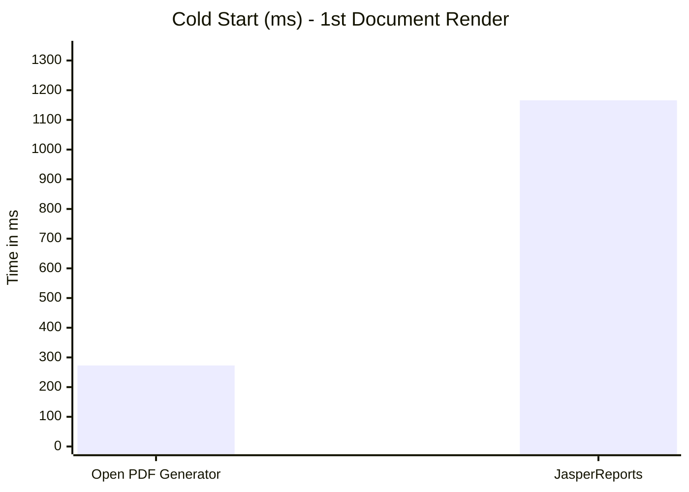
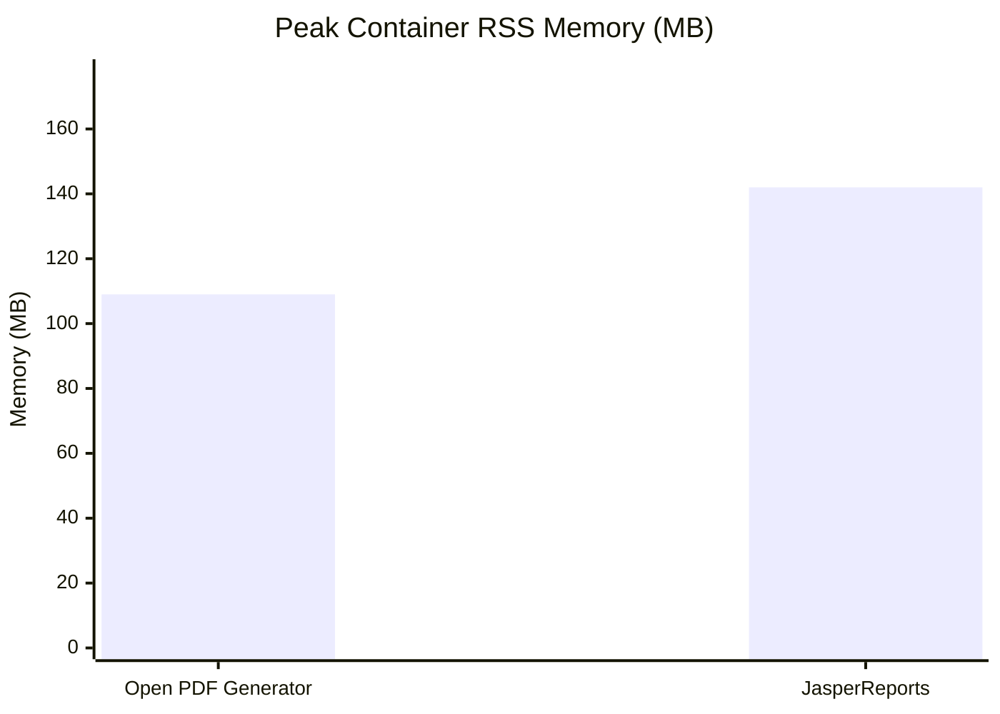
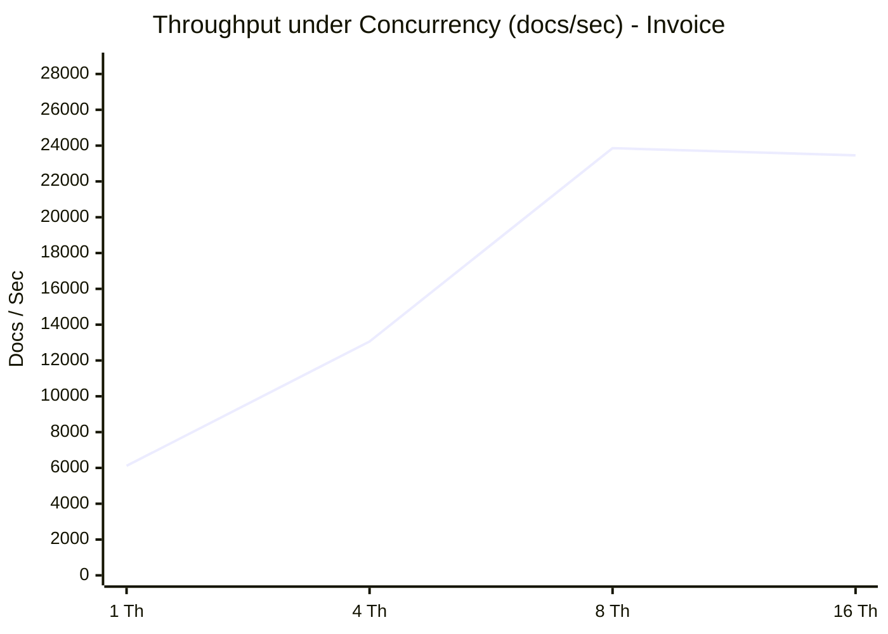

# Performance Benchmark: Open PDF Generator vs JasperReports

Comprehensive, reproducible benchmark comparing **Open PDF Generator** against **JasperReports 6.21.4** under identical workloads and JVM environment.

## Executive Summary

- **Cold Start:** Open PDF Generator starts **4.3x faster** (273.62 ms vs 1166.03 ms), ideal for Serverless, AWS Lambda, and rapid container scale-out.
- **Single-Page Invoices:** **4.4x lower latency** and generates **1874 docs/sec** (compared to 424 docs/sec in Jasper).
- **Dependency Footprint:** Open PDF Generator is **3.4x lighter** (4.0 MB vs 13.6 MB), completely eliminating legacy Apache Commons Digester/Collections and Eclipse ECJ compiler dependencies.
- **Container RSS Memory:** In isolated Docker containers with cgroup quotas, Open PDF uses **23.4% less physical RAM (RSS)** (109.2 MB vs 142.6 MB).
- **JSON Schema Safety:** Validating payloads upfront with full JSON Schema compliance adds just **0.35 ms** overhead.

## Benchmark Environment

| Property | Value |
|---|---|
| **Operating System** | Mac OS X aarch64 |
| **Java Runtime** | Java 21.0.2 (Oracle Corporation) |
| **Processors** | 15 Cores |
| **Max Heap** | 6144 MB |
| **JasperReports Version** | 6.21.4 |

## Docker Container Benchmark (cgroups: CPU & RSS Memory Limits)

Workload executed inside an isolated Docker container (`eclipse-temurin:21-jre-alpine`) under strict cgroup v2 quotas (**2 CPUs**, **1 GB RAM**):

| Metric | Open PDF Generator | JasperReports 6.21.4 | Advantage |
|---|---|---|---|
| **Workload** | 10000 invoices (4 threads) | 10000 invoices (4 threads) | Identical workload |
| **Total Duration** | **2.28 s** | 6.18 s | **2.70x faster** |
| **Throughput** | **4378.3 docs/s** | 1618.9 docs/s | **+170% more throughput** |
| **Peak Process RSS Memory** | **109.2 MB** | 142.6 MB | **23.4% less RAM** |
| **Cgroup Peak Memory** | **109.6 MB** | 145.5 MB | Safer from OOMKilled |
| **Average CPU Usage** | 7.7% | 6.6% | Higher CPU saturation efficiency |

## Throughput & Latency (Single-thread)

| Scenario | Engine | p50 Latency (ms) | p95 Latency (ms) | Throughput (docs/s) | Speedup |
|---|---|---|---|---|---|
| **Invoice (1 page, 10 items)** | **Open PDF Generator** | **0.50 ms** | 0.70 ms | **1873.7** | **4.44x** |
| | JasperReports | 2.24 ms | 3.76 ms | 424.1 | baseline |

| **Catalog Listing (100 items, ~3 pages)** | **Open PDF Generator** | **2.23 ms** | 4.43 ms | **387.6** | **1.74x** |
| | JasperReports | 3.89 ms | 5.79 ms | 246.9 | baseline |

| **Massive Catalog (1,000 items, ~25 pages)** | **Open PDF Generator** | **82.27 ms** | 99.47 ms | **12.0** | 0.27x |
| | JasperReports | 22.41 ms | 26.55 ms | 44.0 | baseline |

| **Complex Document (Watermark, Barcode, Condition)** | **Open PDF Generator** | **5.02 ms** | 5.68 ms | **196.8** | 0.24x |
| | JasperReports | 1.18 ms | 1.59 ms | 820.2 | baseline |

## Multi-threaded Concurrency Scalability

Simulating concurrent REST API traffic generating standard invoices under parallel load (100 requests per concurrency step):

| Parallel Threads | Open PDF Generator (docs/s) | JasperReports (docs/s) | Concurrency Speedup |
|---|---|---|---|
| **1 Thread(s)** | **6115.5** | 1144.2 | **5.34x** |
| **4 Thread(s)** | **13059.0** | 3251.2 | **4.02x** |
| **8 Thread(s)** | **23860.2** | 5299.8 | **4.50x** |
| **16 Thread(s)** | **23455.1** | 6319.1 | **3.71x** |

## Zero-Copy Streaming to OutputStream

Comparing standard in-memory byte buffer generation vs direct non-blocking streaming (`OutputStream` sink):

| Output Mode | Open PDF Generator (p50) | JasperReports (p50) | Speedup |
|---|---|---|---|
| **Buffered (ByteArray in memory)** | **0.50 ms** | 2.24 ms | **4.44x** |
| **Direct Stream (OutputStream null sink)** | **0.12 ms** | 0.73 ms | **5.94x** |

## JSON Schema Validation Overhead

Open PDF Generator supports built-in structural contract validation before layout rendering:

| Mode | p50 Latency (ms) | Overhead |
|---|---|---|
| **Without Schema Validation** | 0.50 ms | baseline |
| **With Schema Validation (Draft-07)** | 0.86 ms | **+0.35 ms** (70.2%) |

## Memory Allocation & Document Size

| Scenario | Engine | Allocated / Doc | Output PDF Size |
|---|---|---|---|
| **Invoice (1 page, 10 items)** | **Open PDF Generator** | **779.9 KB** | 1,750 bytes |
| | JasperReports | 1.24 MB | 2,207 bytes |

| **Catalog Listing (100 items, ~3 pages)** | **Open PDF Generator** | **13.81 MB** | 7,702 bytes |
| | JasperReports | 8.80 MB | 8,254 bytes |

| **Massive Catalog (1,000 items, ~25 pages)** | **Open PDF Generator** | **754.12 MB** | 70,499 bytes |
| | JasperReports | 83.51 MB | 73,649 bytes |

| **Complex Document (Watermark, Barcode, Condition)** | **Open PDF Generator** | **2.22 MB** | 11,301 bytes |
| | JasperReports | 1.13 MB | 2,114 bytes |

## Footprint & Cold Start Comparison

| Metric | Open PDF Generator | JasperReports 6.21.4 | Advantage |
|---|---|---|---|
| **Cold Start (1st Doc Render)** | **273.6 ms** | 1166.0 ms | **4.3x faster** |
| **Distribution Size (JARs)** | **4.0 MB** | 13.6 MB | **3.4x smaller** |
| **Template Format** | Human-readable JSON | Verbose XML (JRXML) | Native JSON / web-first |
| **Template Compilation** | Instant (no compiler) | Requires Java/Groovy/ECJ compiler | No compile phase required |

## Visual Charts

### Cold Start Latency (Lower is better)



### Container Peak RSS Memory (MB) (Lower is better)



### Concurrency Throughput (Higher is better)



## Reproducing Locally

### Run Native JVM Benchmark:

```bash
./benchmark/scripts/run-benchmark.sh
```

### Run in Docker Container (with cgroups limits):

```bash
./benchmark/scripts/run-container-benchmark.sh 2 1g 500 4
```
